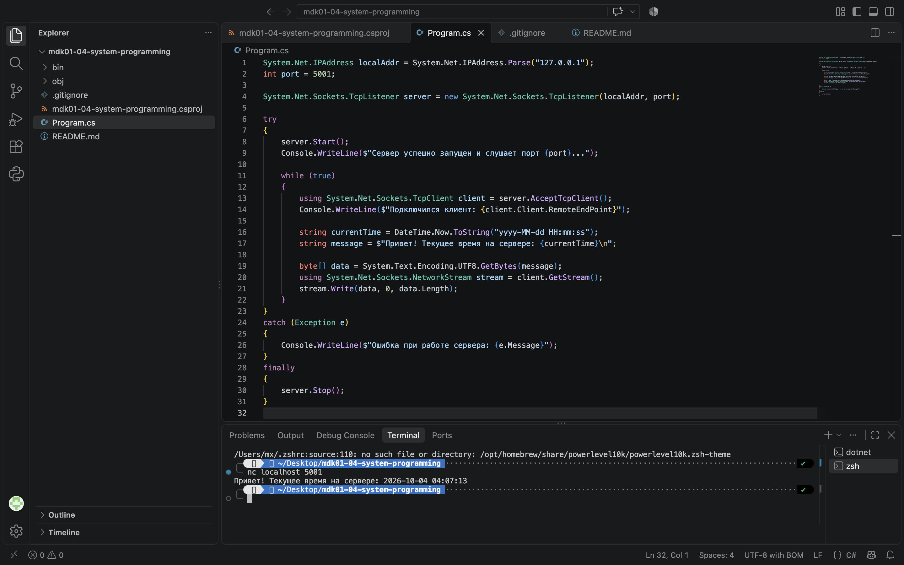

# TCP-сервер точного времени

## Описание
Консольное приложение для создания TCP-сервера, обработки входящих сетевых подключений и вывода текущего системного времени.

## Автор
**Набиев Ислам**

## 🛠️ Технологии
- .NET 10.0
- C#
- System.Net.Sockets

## Использование
```bash
dotnet run
```

=== TCP-СЕРВЕР ТОЧНОГО ВРЕМЕНИ ===

 Разработчик: Набиев Ислам
 Сервер успешно запущен и слушает порт 5001...
 Подключился клиент: 127.0.0.1:54321

## Проверка (Клиент Netcat)
```bash
nc localhost 5001
```

Привет! Текущее время на сервере: 2026-10-04 04:07:13

## Скриншот работы

